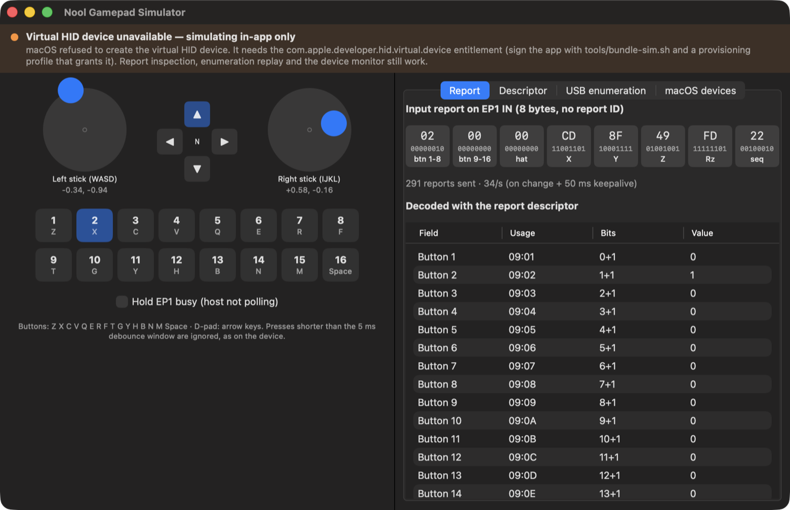
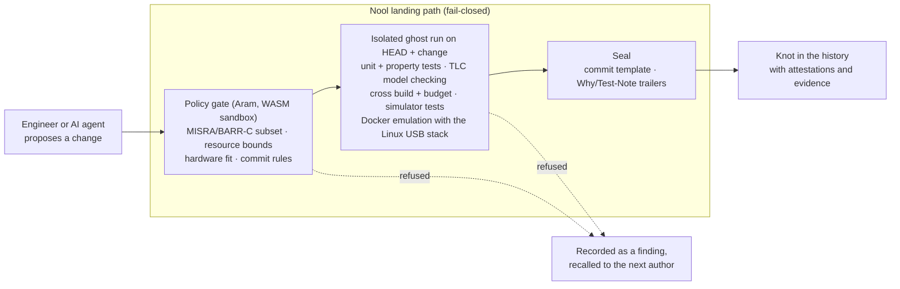
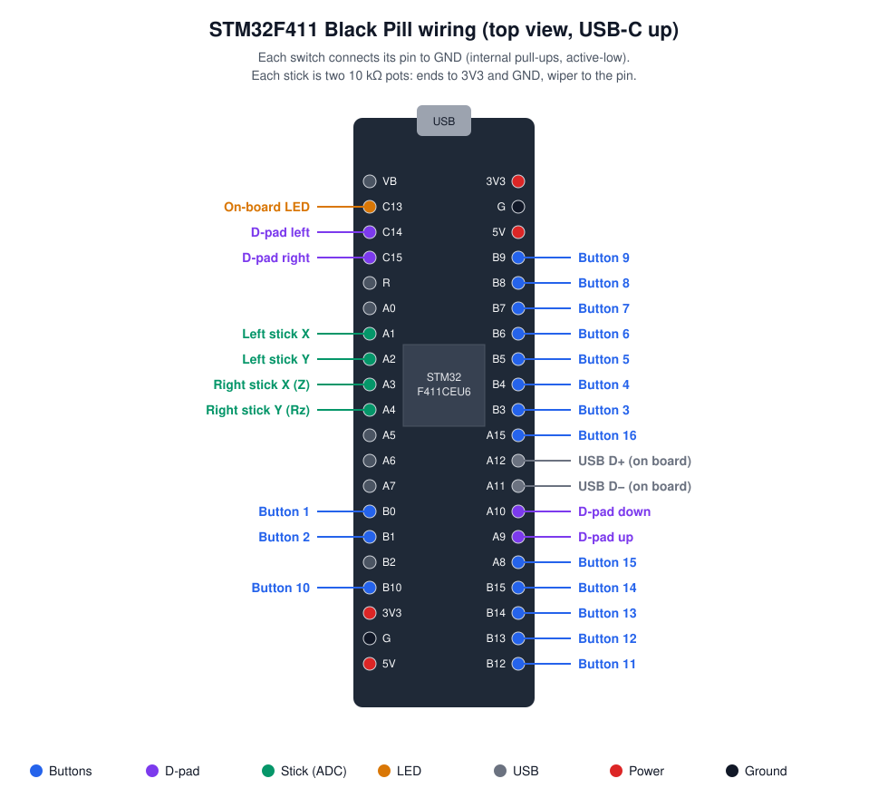
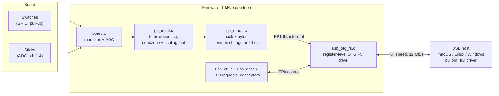
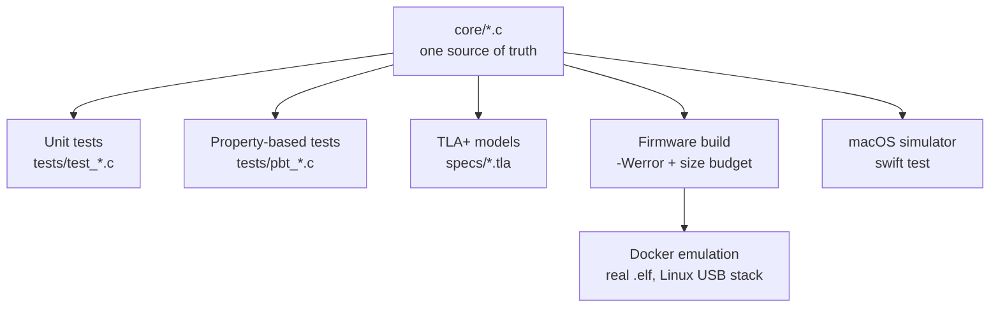
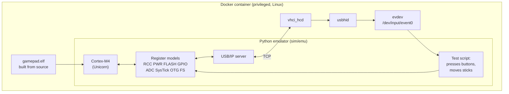
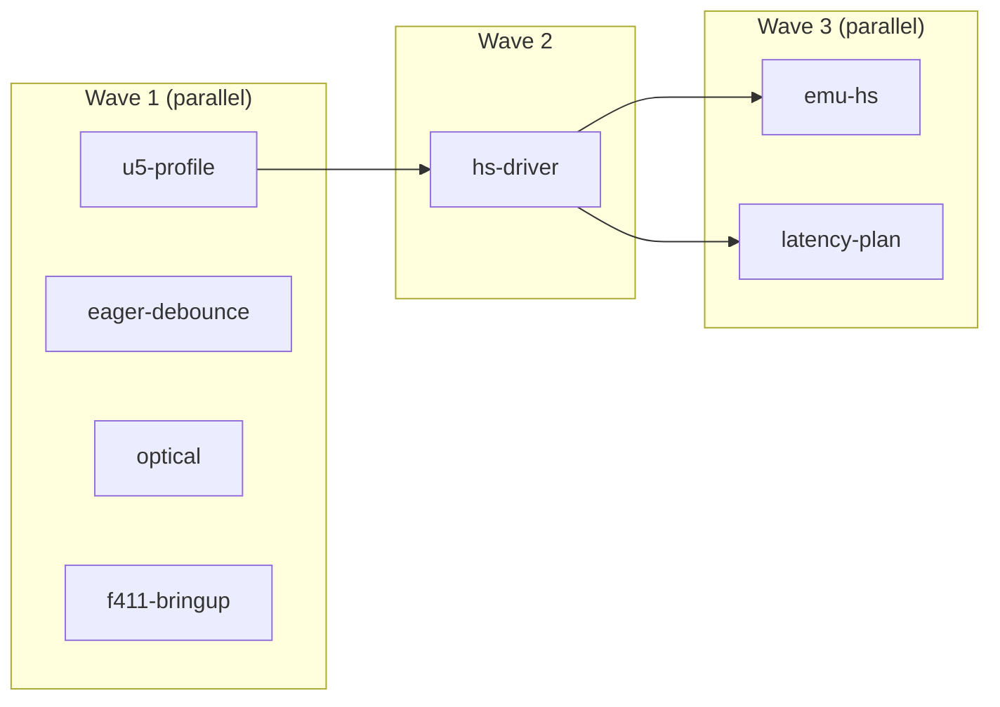

# Verified STM32 Gamepad

Bare-metal firmware for a **USB HID gamepad** on the **STM32F411 "Black Pill"**. It needs no
driver on macOS, Linux or Windows, has no HAL and no C library, and is about 6 KB of flash.

It is also a working demonstration of **[Nool](https://nool.dev)**, a software assurance
substrate. In this repository the specifications are not documents next to the code. The
TLA+ models, the MISRA-style coding rules, the MCU's datasheet limits and the commit
conventions are **executable gates**. Every change has to pass them to enter the history.
[See how it works](#built-on-nool-the-specification-is-the-enforcement-layer), with real
refusals.

The firmware logic is checked in four independent ways before it reaches a board:

1. Unit tests and property-based tests on the host.
2. TLA+ models of the debounce and the USB report path.
3. A Docker emulation that boots the real `.elf` on an emulated STM32F411 and lets the
   Linux kernel enumerate it.
4. A macOS simulator app that runs the same C code.



> **Status.** All automated checks pass, but the firmware **has not yet been run on a physical
> board**. The Docker emulation covers the clock tree, GPIO, ADC and the USB OTG core at
> register level; real silicon and real macOS enumeration still need to be verified.
> Reports from real hardware are welcome.

---

## Contents

- [Built on Nool: the specification is the enforcement layer](#built-on-nool-the-specification-is-the-enforcement-layer)
- [What you need](#what-you-need)
- [Wiring](#wiring)
- [Build and flash](#build-and-flash)
- [How the firmware works](#how-the-firmware-works)
- [The HID report](#the-hid-report)
- [How it is verified](#how-it-is-verified)
- [Docker full-system simulation](#docker-full-system-simulation)
- [macOS simulator](#macos-simulator)
- [Coding rules](#coding-rules)
- [Roadmap: 125 µs latency, planned as a parallel fleet](#roadmap-125-µs-latency-planned-as-a-parallel-fleet)
- [Repository layout](#repository-layout)
- [Contributing](#contributing)
- [License](#license)

## Built on Nool: the specification is the enforcement layer

Embedded teams already write specifications: a state-machine model, a coding standard, a
memory budget taken from the datasheet, a review checklist. The problem is that they are
*advisory*. They live in a wiki or a PDF and are checked by people when someone remembers.
Code drifts from them one commit at a time.

**[Nool](https://nool.dev)** changes where specifications live. Nool is version control built
as a software assurance substrate. A change does not enter the history because someone typed
`commit`. It enters by being *proposed* and passing every gate the repository declares. Each
specification is compiled into one of those gates, so the specification **is** the
enforcement layer, not documentation of it.



### From specification to gate

| Specification | Made executable as | Enforced by Nool at |
|---|---|---|
| **TLA+ models**: `specs/Debounce.tla` (glitches never register; stable input always does) and `specs/UsbHid.tla` (every state change eventually reaches a host that resets, reopens and drops reports) | TLC explores every interleaving. Seeded-bug configurations **must fail**, which shows the properties can catch a bug. A guard checks that the model's constants equal the C constants. | `tla-model-check` gate on every landing |
| **The same properties, applied to the real C code** | Property-based tests (`tests/pbt_*.c`) check the model's invariants on the shipped functions, with shrinking counterexamples | `host-tests` gate |
| **The model's scenarios on real firmware** | The Docker emulation replays them (glitch, reset with a held button) on the real `.elf` against the Linux kernel's HID stack | `docker-usbip-e2e` gate |
| **Coding standard**: MISRA C:2012 / BARR-C:2018 / Power of 10 subset | `emb_c_subset` and `emb_resource_bounds` policies, compiled to WebAssembly | Aram policy gate, before anything is built |
| **Datasheet limits**: 512 KB flash, 128 KB RAM, single-precision FPU, no heap (`policy/hardware-profile.toml`) | `emb_hardware_fit` policy plus a size budget on the linked `.elf` | Aram policy gate + `firmware-build` gate |
| **Change discipline**: every change says what it is, why, and how it was tested | Commit template + `gp_commit_msg` policy | Seal and push |

The gates are declared once in `nool.toml` (`[[reification.checks]]`, mode `block`) and the
policies are pinned by hash in `policies/`. They apply to every author equally: a human, a
script or an AI agent.

### Watch it refuse

These three changes are realistic regressions. Each one was proposed to a copy of this
repository, and Nool refused all three. The output below is real and trimmed.

**1. "Model SET_IDLE 0 as send-on-change only": the formal model is weakened.** Someone
edits `specs/UsbHid.cfg` to turn off the keepalive, so the model matches a literal reading
of the HID specification. TLC finds a behaviour where the host never learns the device's
state, and the landing is refused with the counterexample.

```text
$ tools/propose.sh --type feature --scope tla --title "model SET_IDLE 0 as send-on-change only" … -- specs/UsbHid.cfg
  [Lint] ❌ Speculative Abort: lint check 'tla-model-check' failed:
PASS Debounce (126 distinct states)
FAIL UsbHid
Error: Temporal properties were violated.
Error: The following behavior constitutes a counter-example:
State 1: <Initial predicate>
State 2: <InputChange line 47 of module UsbHid>
State 3: <InputChange line 47 of module UsbHid>
State 4: <BusReset line 55 of module UsbHid>
…
  ✓ Released the lease this propose filed: no candidate was queued.
Error: Lint check 'tla-model-check' failed ([[reification.checks]], mode = "block")
```

The same gate also keeps the model and the code in step. If `GP_DEBOUNCE_MS` in C stops
matching `Window` in `specs/Debounce.cfg`, `tools/check-tla.sh` fails with
`FAIL Debounce.cfg Window=5 but GP_DEBOUNCE_MS=3`.

**2. "Honour SET_IDLE 0 strictly": a plausible reading of the HID spec reintroduces a real
bug.** This is the bug the Docker emulation originally found and `UsbHidNoKeepalive.cfg`
models. The property derived from the model catches it and shrinks it to a minimal trace.

```text
$ tools/propose.sh --type feature --title "honour SET_IDLE 0 strictly" … -- core/gp_report.c
  [Lint] ❌ Speculative Abort: lint check 'host-tests' failed:
FALSIFIED tx_scheduler after 277 case(s)
  shrunk:   silent for 51 ms with the endpoint free (period 50) at step 62
  replay:   PBT_SEED=1785552897 PBT_RUNS=1 (property tx_scheduler)
test_report.c:55: CHECK_EQ failed: sent == 1000 / GP_TX_KEEPALIVE_MS (0 vs 20)
```

**3. "Single exit point": the coding standard is enforced before anything is built.**

```text
$ tools/propose.sh --type feature --title "single exit in gp_tx_step" … -- core/gp_report.c
Error: Gate stack denied [POLICY_DENY] at stage pre-propose:
  [EMB-C-001] core/gp_report.c:94: goto (goto shall not be used)
  -- MISRA C:2012 Rule 15.1; BARR-C:2018 1.7c; Power of 10 Rule 1
  deviate: /* EMB-DEVIATION(EMB-C-001): <reason> */ on or above the line
```

The policy also shows the **sanctioned way out**. A justified deviation comment is the only
way past a rule, and it stays in the code where reviewers and auditors can see it.

### Evidence, not trust

Every change that does land carries a record of what was checked. For example, the
emulator fix in this repository:

```text
$ nool evidence knot bfc9ff18
  Intent      : bug(emu): Docker sim exits 139 after all checks pass
  Policy Results (7):
    • policy emb_c_subset: allow [351da1a509b7]
    • policy emb_hardware_fit: allow [94c6de8ee0ed]
    • policy emb_resource_bounds: allow [da5bbe3f561c]
    • policy gp_commit_msg: allow [f4c3ded057da]
    • authority: local backend, lease 902072fd9551 seq 52 confirmed
  Attestations (4):
    • compile: pass by integrity-driver
    • lint: pass by docker-usbip-e2e
    • declared-scope: pass by lease
```

Evidence can be exported (`nool evidence export`) and checked offline as DSSE / in-toto /
SLSA bundles (`nool verify-bundle`). That is the material a functional-safety or
supply-chain audit asks for.

### Why it matters with AI agents

Much of this repository was written with AI coding agents. Agents produce code quickly, so the
question becomes what stops them landing code that is plausible but wrong. With Nool the
answer is the same specifications a careful engineer would check by hand, applied
automatically and without exception:

- **Refusals become memory.** A refused attempt is stored as a finding and shown to the next
  agent or engineer who touches those files, so the same mistake is not proposed twice.
- **Agents coordinate through leases.** Agents announce what they are changing and take
  leases, so parallel work does not collide.
- **Fleets are planned up front.** `nool fleet plan` splits work into waves of tasks that
  touch disjoint files; see the [roadmap](#roadmap-125-µs-latency-planned-as-a-parallel-fleet).

You do not need Nool to build, test or flash this project; `tools/check-all.sh` runs the
same checks by hand. Nool is what makes them **non-optional**. Learn more at
**[nool.dev](https://nool.dev)**.

## What you need

**Hardware**

| Part | Notes |
|---|---|
| STM32F411CEU6 Black Pill (WeAct v2.0 / v3.0) | 25 MHz crystal is assumed (`firmware/stm32f411/clock.c`) |
| Up to 16 push buttons + 4 for the d-pad | any momentary switch, wired to GND |
| 2 analog thumbsticks (or 4 × 10 kΩ pots) | 3.3 V supply, wiper to the ADC pin |
| USB-C cable | the board is powered and enumerated over USB |
| *(optional)* ST-Link V2 | otherwise flash over USB DFU, no extra hardware |

**Tools** (macOS with Homebrew shown; any Linux works for everything except the simulator app)

```sh
brew install cmake arm-none-eabi-gcc python3   # build
brew install dfu-util stlink                    # flash (either one)
brew install --cask temurin                     # Java for the TLA+ model checker
# TLC: download tla2tools.jar and put a `tlc` wrapper on PATH:
#   java -XX:+UseParallelGC -cp /path/to/tla2tools.jar tlc2.TLC "$@"
# Docker Desktop: for the full-system simulation
# Xcode 16 / Swift 6, macOS 15+: for the simulator app
```

Homebrew's `arm-none-eabi-gcc` ships without newlib. That is fine here, because the
firmware is built `-ffreestanding -nostdlib` and brings its own `memcpy`/`memset`
(`firmware/stm32f411/mem.c`).

## Wiring



- **Switches.** Every switch goes between its pin and **GND**. The firmware enables the internal
  pull-ups, so a pressed switch reads low. No external resistors are needed.
- **Sticks.** Each axis is a potentiometer: the ends go to 3V3 and GND, and the wiper goes to
  the ADC pin. Mid-travel should read about 2048 counts; a ±96-count deadzone is applied.
  Swap the pot ends if an axis is reversed.
- **LED.** The on-board LED on PC13 lights once the host has configured the device.
- **Unused pins.** PA0 (the KEY button), PA5–PA7 and PB2 (BOOT1) are free.
- **Header order.** The wiring diagram shows the WeAct board's header order; check it
  against your board's silkscreen.
- **D-pad on PC14/PC15.** These pins also go to the 32.768 kHz crystal footprint. If the
  d-pad left/right readings are unreliable, move them to free pins.

The pin map lives in `firmware/stm32f411/board.c`. After changing it, regenerate the
diagram with `python3 tools/gen-wiring-svg.py docs/images/wiring.svg`.

## Build and flash

```sh
# Firmware: build/firmware/firmware/stm32f411/gamepad.{elf,bin}
cmake --preset firmware && cmake --build --preset firmware

# Flash over USB DFU. Hold BOOT0, tap NRST, release BOOT0, then:
tools/flash.sh dfu
# ...or with an ST-Link on SWD:
tools/flash.sh stlink

# Host tests and every other check
tools/check-all.sh            # about 1 minute warm; add --no-docker to skip the emulation
```

`tools/flash.sh` rebuilds the firmware first and refuses to flash if the image is over the
flash/RAM budget in `policy/hardware-profile.toml` (85 % warning, 95 % error). Today it uses
about 5.8 KB of 512 KB flash and 4.3 KB of 128 KB RAM.

**Check it on the Mac.** System Information › USB should list *Nool STM32 Gamepad*
(`1209:0001`). You can also run the simulator app (`swift run GamepadSim`) and open the
**macOS devices** tab, which decodes the board's live reports. Any browser gamepad tester
(the Gamepad API) works too.

> **VID/PID.** `1209:0001` is the pid.codes *test* ID. Get your own PID before you
> distribute devices. The values are in `core/usb_desc.c`.

## How the firmware works



The firmware is a **polled superloop with no RTOS and no USB interrupts**. SysTick fires
every 1 ms. On each tick the loop:

1. **Services USB.** It drains the OTG RX FIFO, answers control requests on EP0, and
   detects bus reset and configuration.
2. **Scans the inputs.** It reads 20 digital inputs and does 4 ADC conversions; each
   conversion has a bounded timeout.
3. **Debounces.** Each input has a saturating integrator. A change must be seen for a net
   5 ms (`GP_DEBOUNCE_MS`) before it is reported, so bounce shorter than that is ignored.
4. **Schedules the report.** If EP1 is free, it builds the report and queues it when the
   state changed, or when 50 ms have passed since the last one (`GP_TX_KEEPALIVE_MS`).

- **Clock.** The 25 MHz HSE feeds the PLL, giving 96 MHz SYSCLK and the 48 MHz USB clock.
  Every wait for a ready flag has a timeout.
- **Latency.** Input-to-host latency is the debounce window plus at most 1 ms of polling:
  about **6 ms worst case** for buttons and about 2 ms for sticks.

**Why the 50 ms keepalive?** Strictly, SET_IDLE 0 means "send only on change". But Linux's
`usbhid` discards input reports for about 50 ms after an application opens the device. A
button held across that window was then never reported. The Docker emulation found this,
and the TLA+ model now reproduces it. Re-sending the state every 50 ms fixes it on every OS,
at negligible bus cost.

The hardware-independent code is in `core/` and has no register access. The firmware, the
host tests and the simulator app all compile these same files.

## The HID report

One 8-byte input report on EP1 IN, with no report ID. The interface uses the Generic
Desktop / **Game Pad** usage, so every OS binds its own driver.

| Byte | Content |
|---|---|
| 0–1 | Buttons 1–16 (bit 0 of byte 0 = button 1) |
| 2 | Hat switch in bits 0–3: 0 = N, 1 = NE … 7 = NW, 8 = centred (null state) |
| 3, 4 | Left stick X, Y as int8, −127…127 (+Y = down) |
| 5, 6 | Right stick Z, Rz as int8, −127…127 |
| 7 | Sequence counter (vendor-defined; useful for spotting dropped reports) |

The full 88-byte report descriptor is in `core/usb_desc.c`. The tests parse it back and
check it against this layout.

On macOS the pad works with SDL, the browser Gamepad API, IOHIDManager and CoreHID. Apple's
`GameController.framework` only lists controllers it has a profile for, so games that use
only that framework won't see a generic HID pad.

## How it is verified



| Check | What it catches | Run it |
|---|---|---|
| **Unit tests** | Wrong report packing, wrong descriptors, wrong EP0 replies to a scripted enumeration, debounce/deadzone edge cases | `ctest --preset host` |
| **Property-based tests** | Bugs that only appear for unusual input sequences. A small Hypothesis-style harness (`tests/pbt.h`) generates thousands of random input timelines and checks invariants such as "a glitch shorter than 5 ms never registers" or "the host is never left with a stale state". On failure it shrinks the case to a minimal counterexample and prints a replay line: `PBT_SEED=<seed> PBT_RUNS=1 build/host/tests/pbt_input` | `ctest --preset host` |
| **TLA+ model checking** | Design-level timing and protocol bugs. The model checker TLC explores every interleaving of the models. `Debounce.tla`: stable inputs are always reported, and short glitches never are. `UsbHid.tla`: enumeration, bus resets, and a host that opens/closes the device and drops early reports; every state change eventually reaches the host. Each model also has a **seeded-bug configuration that must fail**, which shows the properties would catch the bug. The script also checks that the model's debounce window equals `GP_DEBOUNCE_MS` in the C code. | `tools/check-tla.sh` |
| **Firmware build** | Compiler warnings (`-Werror`), and flash/RAM over budget | `cmake --build --preset firmware` |
| **Docker emulation** | Register-level mistakes (clock enables, pull-ups, FIFO handling, endpoint setup), and anything the real Linux USB/HID stack disagrees with | `tools/docker-sim.sh` |
| **Simulator tests** | Descriptor parsing, enumeration replay and report decoding in the Swift app | `swift test` |

`tools/check-all.sh` runs all of these and prints `ALL CHECKS PASS`.

## Docker full-system simulation



```sh
tools/docker-sim.sh          # build image + firmware, run 33 checks (about 20 s warm)
tools/docker-sim.sh --shell  # same image, interactive shell
```

The container compiles the firmware from source and runs the real `gamepad.elf` on an
emulated Cortex-M4. The peripherals are register-level models written from the reference
manual (RM0383). Clock gating, GPIO pull-ups and the OTG FS RX/TX FIFO protocol are modelled,
so a firmware mistake in any of them fails a check. The emulated device is exported over
**USB/IP** and attached to the **Linux kernel's own USB host and HID drivers** in the same
container.

The test checks:

- **Boot:** the clock tree comes up at 96/48 MHz and the device soft-connects.
- **Enumeration:** strings, serial number, speed and interface class, as Linux reads them.
- **Report descriptor:** the kernel's copy is byte-identical to the firmware's.
- **Input path:** evdev codes and ranges for all buttons, both sticks and the hat.
- **Debounce:** a 3 ms glitch is rejected and an 8 ms press registers.
- **Reset:** after a USB detach and reattach with a button held, the host still sees it.

Time is virtual: one instruction counts as one cycle at 96 MHz. The emulation runs slower
than real time, but timing-dependent firmware behaviour is deterministic.

## macOS simulator

```sh
swift run GamepadSim          # or --demo for animated input
swift test                    # simulator tests
tools/bundle-sim.sh           # build/GamepadSim.app
```

- **Virtual pad.** Drag the sticks, click the buttons, or use the keyboard: WASD and IJKL
  are the sticks, the arrow keys are the d-pad, and buttons 1–16 are
  `Z X C V Q E R F T G Y H B N M Space`. Input goes through the firmware's own C core at
  1 kHz, so debounce behaves exactly as on the board.
- **Report.** The live 8 bytes in hex and binary, decoded field by field using the report
  descriptor.
- **USB enumeration.** Replays a macOS-style enumeration against `core/usb_ctrl.c` and shows
  each request and reply.
- **macOS devices.** Lists every gamepad macOS sees, including a flashed Black Pill, and
  decodes its reports. This is the quickest way to check real hardware.
- **Virtual HID device.** The app can also appear to macOS as a real gamepad. This needs
  Apple's restricted `com.apple.developer.hid.virtual.device` entitlement:
  `SIGN_ID=… PROFILE=….provisionprofile BUNDLE_ID=… tools/bundle-sim.sh`. Without it the app
  shows the orange banner in the screenshot above, and everything else still works.

## Coding rules

The C code follows a MISRA-C / BARR-C-style subset. These are the rules that matter when
you edit it:

- **Language:** C11, no compiler extensions; braces on every `if`/`else`/loop body; no
  `goto`, no octal literals, no token pasting (`##`).
- **Memory:** no heap (`malloc`), no recursion, at most two levels of pointer indirection,
  large buffers `static` rather than on the stack.
- **Control flow:**
  - every loop has a fixed bound; only `main`'s superloop is infinite, and every
    hardware-polling loop has a timeout;
  - every `switch` has a `default` and a `break` per case;
  - functions are at most 60 lines.
- **No `printf` or stdio, no floating point.**
- **Fit:** the image must stay within the flash/RAM budget for the STM32F411CEU6
  (`policy/hardware-profile.toml`).

Nool enforces these rules on every change through the `emb_c_subset`, `emb_resource_bounds`
and `emb_hardware_fit` policies; see [Watch it refuse](#watch-it-refuse).
`tests/` is exempt.

## Roadmap: 125 µs latency, planned as a parallel fleet

The next version aims at **125 µs input-to-host latency**, which is one USB High-Speed
microframe. Full-speed USB cannot get there, because it polls at most once per 1 ms frame.

- **MCU:** move to an MCU with an integrated High-Speed PHY (STM32U5A5).
- **Reports:** send them at `bInterval 1` (8 kHz), timed just before each start-of-frame.
- **Switches:** replace mechanical switches and the 5 ms debounce with optical switches,
  which do not bounce. They are read through strobed IR LEDs with ambient-light
  differencing and hysteresis.

The work is split into seven tasks, each with a declared **file footprint**:

| Task | Footprint | Needs |
|---|---|---|
| `u5-profile`: U5A5 hardware profile, rebuild the policies | `policy/hardware-profile-u5a5.toml`, `tools/build-policies.sh` | |
| `hs-driver`: High-Speed OTG driver, SOF-synchronised reports, qualifier descriptors | `firmware/stm32u5a5/` | `u5-profile` |
| `eager-debounce`: report on the first edge, then lock out; TLA+ and PBT updated | `core/gp_input.*`, `specs/Debounce.tla`, `tests/pbt_input.c` | |
| `optical`: optical sensing, hysteresis, calibration; new TLA+ model and PBT | `core/gp_optical.*`, `specs/Hysteresis.tla`, `tests/pbt_optical.c` | |
| `emu-hs`: High-Speed OTG model; the emulation asserts data age ≤ 125 µs | `sim/emu/` | `hs-driver` |
| `latency-plan`: hardware latency measurement (logic analyser + USB sniffer) | `docs/latency-test-plan.md` | `hs-driver` |
| `f411-bringup`: verify the current firmware on a real Black Pill | `firmware/stm32f411/` | |

**How the plan is computed.** The maintainers use `nool fleet plan` to decide what can be
built in parallel. It takes the tasks' file footprints and splits them into **waves**: the
tasks in one wave share no files, so parallel agents (or engineers) can never edit the same
code. The command only plans; nothing runs and nothing is spent. Here is its output for the
tasks above:

```text
$ nool fleet plan --width 4 --task 'u5-profile=…' --task 'hs-driver=…' …
Fleet plan (7 task(s), max width 4):
  wave 1: u5-profile, hs-driver, eager-debounce, optical
  wave 2: emu-hs, latency-plan, f411-bringup
Parallel width (Invariant C1, disjoint per wave): 4
Serial (0, take turns over a shared scope): none
```

**Ordering by dependencies.** The quick `--task` form above only sees file overlap. Once the
"Needs" column is recorded as task dependencies (`--depends-on`), the planner also orders
by dependency, and the plan becomes:



**Capacity.** `nool fleet capacity` reports how wide a fleet this machine can run. Here it
is bound by free disk, at 8 GB per isolated build, so the actual width is 2.

**Running the fleet.** `nool fleet start` and `nool fleet code` run the plan:

1. Each task gets a builder agent in its own worktree.
2. A quorum of reviewer agents judges each result.
3. Each task lands only through the same gates as a human change: the coding rules,
   unit tests, PBT, TLC, the size budget and the Docker emulation. Tasks land in
   dependency order.

The fleet is optional tooling: every task above can equally be picked up by hand.

## Repository layout

```
core/                portable C shared by firmware, tests and simulator:
                     debounce, HID report, descriptors, EP0 state machine
firmware/stm32f411/  register map, startup, clock, GPIO/ADC, OTG FS driver, main loop, linker script
tests/               host unit tests (test_*) and property-based tests (pbt_*)
specs/               TLA+ models and seeded-bug configurations
sim/GamepadSim/      SwiftUI simulator app (Package.swift is at the repo root)
sim/emu/             Python full-system emulator and the USB/IP end-to-end test
docker/              Dockerfile for the emulation
docs/images/         README images
policy/              hardware profile (MCU limits, budget) and commit message template
policy-src/          commit-message policy (Rust, compiled to WebAssembly)
policies/, nool.toml repository tooling configuration (see below)
tools/               check-all, flash, TLC runner, size budget, simulator bundling, etc.
```

## Contributing

You need nothing beyond the tools above to build, test or flash: **run
`tools/check-all.sh`, then open a pull request.**

**About Nool.** This repository is managed with [Nool](https://nool.dev); see
[Built on Nool](#built-on-nool-the-specification-is-the-enforcement-layer). When a maintainer
lands your pull request, Nool re-runs every check in `tools/check-all.sh` and the coding-rule
policies. A change that fails any of them cannot land. GitHub shows the result as ordinary
git commits. The `refs/nool/*` refs, `nool.toml`, `policies/` and `compile_commands.json`
exist for Nool; you can ignore them.

**Commit messages** follow a template, which the tooling enforces:

```
feature(core): short title, at most 72 characters

Nool-Why: what changed and why (at least 20 characters)
Nool-Test-Note: what you ran to test it
```

The type is `feature` or `bug`. The scope is optional and is usually the top-level directory.
For maintainers, `tools/propose.sh` fills this in:
`tools/propose.sh --type bug --scope core --title "…" --description "…" --tested "…" -- <files>`.

## License

MIT; see [LICENSE](LICENSE). `tools/size_budget.py` is vendored from EmbeddedPolicyPack,
also under the MIT licence.
